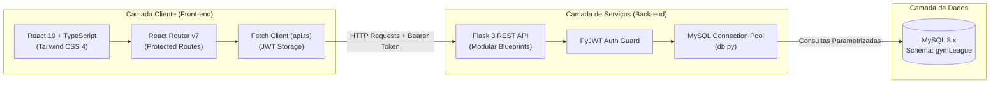

# 🏋️‍♂️ GymLeague

<p align="center">
  <strong>Plataforma Full-Stack para Gestão de Treinos, Acompanhamento de Evolução Física e Gamificação de Desempenho.</strong>
</p>

<p align="center">
  
  
  
  
  
  
  
  
</p>

---

## 📌 Sumário

- [Sobre o Projeto](#-sobre-o-projeto)
- [Funcionalidades Principais](#-funcionalidades-principais)
- [Telas e Navegação](#-telas-e-navegação)
- [Arquitetura da Solução](#-arquitetura-da-solução)
- [Tecnologias Utilizadas](#-tecnologias-utilizadas)
- [Estrutura do Repositório](#-estrutura-do-repositório)
- [Pré-requisitos](#-pré-requisitos)
- [Guia de Instalação e Execução](#-guia-de-instalação-e-execução)
  - [1. Clonar o Repositório](#1-clonar-o-repositório)
  - [2. Configuração do Banco de Dados (MySQL)](#2-configuração-do-banco-de-dados-mysql)
  - [3. Configuração do Back-end (Flask)](#3-configuração-do-back-end-flask)
  - [4. Configuração do Front-end (React)](#4-configuração-do-front-end-react)
- [Variáveis de Ambiente](#-variáveis-de-ambiente)
- [Endpoints da API](#-endpoints-da-api)
- [Modelagem do Banco de Dados](#-modelagem-do-banco-de-dados)
- [Scripts e Comandos Úteis](#-scripts-e-comandos-úteis)
- [Autoria e Créditos](#-autoria-e-créditos)

---

## 📖 Sobre o Projeto

O **GymLeague** é uma aplicação web moderna voltada para frequentadores de academia e praticantes de musculação que desejam maximizar seus resultados. A plataforma resolve o desafio comum de perda de consistência e falta de controle sobre a progressão de cargas, histórico de peso e evolução corporal.

Além de permitir a criação detalhada de rotinas e fichas de treino (séries, repetições e exercícios associados a grupos musculares), o GymLeague traz um **sistema de ranking e gamificação**, estimulando o usuário a superar seus limites e comparar seu desempenho por grupos musculares específicos e geral.

> 🎓 Projeto acadêmico desenvolvido no âmbito da disciplina de **Engenharia de Software** no Departamento de Ciência da Computação da **Universidade Federal de São João del-Rei (UFSJ)**.

---

## ✨ Funcionalidades Principais

- 📋 **Gestão de Rotinas e Treinos:**
  - Criação, edição e exclusão de rotinas personalizadas (ex.: ABC, Upper/Lower, Full Body).
  - Organização de treinos com número de séries, repetições alvo e descrições.
  - Opção de tornar rotinas públicas ou privadas.

- ⏱️ **Modo Execução de Treino ("Treinar"):**
  - Interface dedicada para registro de treinos no dia a dia.
  - Apontamento real de cargas e repetições executadas em cada série.

- 🌐 **Explorar Rotinas Comunitárias:**
  - Descubra e visualize rotinas criadas por outros usuários da comunidade.
  - Compartilhamento facilitado para inspiração de novos treinos.

- 📊 **Monitoramento de Evolução Física:**
  - Acompanhamento do histórico de peso corporal e percentual de gordura.
  - Gráficos interativos com progressão de cargas por exercício e volume ao longo do tempo.

- 🏆 **Gamificação e Rankings:**
  - Pontuação e classificação de usuários baseada na consistência e cargas levantadas.
  - Classificação por **Grupo Muscular**, **Músculo Específico** e **Ranking Geral**.

- 🎯 **Gestão de Metas:**
  - Definição de objetivos individuais (meta de carga em exercício, peso corporal, repetições).
  - Acompanhamento visual da taxa de conclusão das metas.

- 📚 **Catálogo de Exercícios e Músculos:**
  - Cadastro de novos exercícios com vinculação anatômica direta a músculos e grupos musculares.

- 🔐 **Autenticação Segura com JWT:**
  - Fluxo stateless de login e cadastro.
  - Sessão persistida em cliente e rotas protegidas por middleware de autorização.

---

## 🖥️ Telas e Navegação

A interface é construída em Single Page Application (SPA), garantindo transições instantâneas:

| Rota | Acesso | Descrição |
| :--- | :---: | :--- |
| `/` | Público | **Landing Page:** Apresentação da plataforma e chamada para ação |
| `/login` | Público | **Autenticação:** Acesso à conta existente |
| `/cadastro` | Público | **Novo Usuário:** Registro de credenciais e dados biométricos iniciais |
| `/home` | Protegido | **Dashboard:** Painel principal com resumo diário, metas e atalhos |
| `/meus-treinos` | Protegido | **Gestão de Treinos:** Criação e manutenção de rotinas e fichas |
| `/treinar` | Protegido | **Execução:** Registro ativo de treinos e séries concluídas |
| `/explorar-rotinas`| Protegido | **Comunidade:** Exploração de rotinas públicas de outros atletas |
| `/evolucao` | Protegido | **Gráficos & Métricas:** Acompanhamento de peso e cargas |
| `/ranking` | Protegido | **Leaderboard:** Classificações musculares e gerais |
| `/inserir-exercicio`| Protegido | **Catálogo:** Cadastro de novos exercícios e mapeamento muscular |
| `/perfil` | Protegido | **Perfil:** Gestão de medidas corporais e preferências |

---

## 🏛️ Arquitetura da Solução

O sistema adota uma arquitetura desacoplada em duas camadas principais, integradas via API REST com autenticação Bearer JWT:



### Fluxo de Autenticação

1. O usuário submete credenciais na tela de Login ou Cadastro (`/auth/login` ou `/auth/register`).
2. O backend valida a senha, gera um token JWT com tempo de expiração e devolve o token junto aos dados do perfil.
3. O front-end salva o token em `localStorage` e o injeta automaticamente no header `Authorization: Bearer <token>` em todas as requisições protegidas.
4. Caso o token expire ou seja inválido, o front-end redireciona o usuário para a tela inicial.

---

## 💻 Tecnologias Utilizadas

### Front-end
- **[React 19](https://react.dev/):** Biblioteca para interfaces reativas baseadas em componentes.
- **[TypeScript](https://www.typescriptlang.org/):** Tipagem estática para robustez e manutenção do código.
- **[Vite 7](https://vite.dev/):** Ferramenta de build e servidor de desenvolvimento ultra-rápido com HMR.
- **[Tailwind CSS 4](https://tailwindcss.com/):** Framework utilitário de estilos com alto desempenho.
- **[React Router DOM v7](https://reactrouter.com/):** Gerenciamento dinâmico de rotas e proteção de páginas privadas.
- **[Recharts](https://recharts.org/) & [D3-Scale](https://d3js.org/d3-scale):** Gráficos ricos para visualização da evolução física.
- **[React Icons](https://react-icons.github.io/react-icons/):** Pacote de ícones otimizado.

### Back-end
- **[Python 3.11+](https://www.python.org/):** Linguagem base da camada servidora.
- **[Flask 3](https://flask.palletsprojects.com/):** Microframework web estruturado com Blueprints modulares.
- **[Flask-CORS](https://flask-cors.readthedocs.io/):** Controle de políticas de Cross-Origin Resource Sharing.
- **[PyJWT](https://pyjwt.readthedocs.io/):** Emissão e decodificação segura de tokens JSON Web Token.
- **[mysql-connector-python](https://dev.mysql.com/doc/connector-python/en/):** Driver oficial MySQL com suporte nativo a pool de conexões.
- **[python-dotenv](https://github.com/theskumar/python-dotenv):** Carregamento de variáveis de ambiente a partir de arquivos `.env`.

### Banco de Dados & Infra
- **[MySQL 8.x](https://www.mysql.com/):** Banco de dados relacional para persistência transacional com constraints de integridade referencial (`CASCADE`, `SET NULL`).

---

## 📁 Estrutura do Repositório

```text
GymLeague/
├── backend/                       # Servidor Flask (API REST)
│   ├── routes/                    # Blueprints organizados por domínio
│   │   ├── auth.py                # Login, cadastro e verificação JWT
│   │   ├── users.py               # Operações e perfil de usuário
│   │   ├── rotina_routes.py       # Gestão de rotinas e fichas
│   │   ├── treinar_routes.py      # Execução de treinos e séries
│   │   ├── evolucao_routes.py     # Histórico de cargas e medidas
│   │   ├── ranking.py             # Lógica de rankings musculares/geral
│   │   ├── metas.py               # Definição e acompanhamento de metas
│   │   ├── exercicios_routes.py   # Consulta de exercícios
│   │   ├── inserirExercicio.py    # Cadastro de exercícios e vínculos
│   │   ├── grupos_routes.py       # Grupos musculares
│   │   ├── musculos_routes.py     # Músculos anatômicos
│   │   └── home_routes.py         # Resumo do painel inicial
│   ├── utils/                     # Utilitários (ex.: validação JWT)
│   ├── app.py                     # Entry point da aplicação Flask
│   ├── db.py                      # Configuração e pool de conexão MySQL
│   ├── requirements.txt           # Dependências Python
│   └── .env.example               # Modelo de variáveis de ambiente
│
├── frontend/                      # Aplicação React (SPA)
│   ├── src/
│   │   ├── app/                   # Configuração de rotas e providers
│   │   ├── components/            # Componentes reutilizáveis
│   │   │   ├── auth/              # Componentes de autenticação
│   │   │   ├── evolucao/          # Componentes de métricas e gráficos
│   │   │   ├── home/              # Cards e widgets da dashboard
│   │   │   ├── ranking/           # Tabelas e pódios de ranking
│   │   │   ├── treinos/           # Componentes de montagem de treino
│   │   │   └── ui/                # Botões, modais e inputs base
│   │   ├── libs/                  # Utilitários (api.ts, auth.ts)
│   │   ├── pages/                 # Páginas da aplicação
│   │   ├── styles/                # CSS global e Tailwind
│   │   ├── type/                  # Interfaces e DTOs TypeScript
│   │   ├── App.tsx                # Definição das rotas principais
│   │   └── main.tsx               # Entry point do React
│   ├── package.json               # Dependências e scripts npm
│   ├── vite.config.ts             # Configuração do Vite
│   └── .env.example               # Modelo de variáveis de ambiente
│
├── doc/                           # Documentação técnica do projeto
│   ├── chapters/                  # Capítulos em LaTeX (UFSJ)
│   ├── documentacaoBancoDeDados.md# Dicionário de dados completo
│   └── main.tex                   # Documento acadêmico compilável
│
├── .gitignore                     # Regras de exclusão do Git
└── README.md                      # Você está aqui!
```

---

## ⚙️ Pré-requisitos

Certifique-se de ter instalado em sua máquina:

- **[Git](https://git-scm.com/)**
- **[Node.js](https://nodejs.org/)** (versão 18 LTS ou superior) e **npm**
- **[Python](https://www.python.org/)** (versão 3.11 ou superior) e **pip**
- **[MySQL Server](https://dev.mysql.com/downloads/mysql/)** (versão 8.0 ou superior) em execução

---

## 🚀 Guia de Instalação e Execução

### 1. Clonar o Repositório

```bash
git clone https://github.com/SEU-USUARIO/GymLeague.git
cd GymLeague
```

---

### 2. Configuração do Banco de Dados (MySQL)

Acesse seu terminal MySQL e crie o banco de dados `gymLeague`:

```sql
CREATE DATABASE IF NOT EXISTS gymLeague CHARACTER SET utf8mb4 COLLATE utf8mb4_unicode_ci;
```

A estrutura de tabelas detalhada com chaves primárias, estrangeiras e restrições pode ser consultada no documento oficial:
👉 [Documentação do Banco de Dados (`doc/documentacaoBancoDeDados.md`)](doc/documentacaoBancoDeDados.md)

---

### 3. Configuração do Back-end (Flask)

1. **Acesse o diretório do backend:**
   ```bash
   cd backend
   ```

2. **Crie e ative o ambiente virtual (`venv`):**
   - **Linux / macOS:**
     ```bash
     python3 -m venv venv
     source venv/bin/activate
     ```
   - **Windows (PowerShell / Prompt):**
     ```cmd
     python -m venv venv
     venv\Scripts\activate
     ```

3. **Instale as dependências:**
   ```bash
   pip install --upgrade pip
   pip install -r requirements.txt
   ```

4. **Configure as variáveis de ambiente:**
   Copie o arquivo de exemplo e preencha com as credenciais do seu MySQL:
   ```bash
   cp .env.example .env
   ```
   *Edite o arquivo `.env` gerado caso a sua senha ou porta do MySQL sejam diferentes.*

5. **Inicie o servidor Flask:**
   ```bash
   python app.py
   ```
   > O servidor será iniciado em: `http://localhost:5000`

6. **Valide a execução:**
   Abra uma nova aba ou terminal e execute:
   ```bash
   curl http://localhost:5000/health
   # Resposta esperada: {"status": "ok"}
   ```

---

### 4. Configuração do Front-end (React)

1. **Abra um novo terminal e acesse a pasta `frontend`:**
   ```bash
   cd frontend
   ```

2. **Instale as dependências do projeto:**
   ```bash
   npm install
   ```

3. **Configure as variáveis de ambiente:**
   ```bash
   cp .env.example .env
   ```
   *(Por padrão, `VITE_API_URL` já aponta para `http://localhost:5000`)*

4. **Inicie o servidor de desenvolvimento Vite:**
   ```bash
   npm run dev
   ```

5. **Acesse a aplicação no navegador:**
   > Abra: **`http://localhost:5173`** 🎉

---

## 🔐 Variáveis de Ambiente

### Back-end (`backend/.env`)

| Variável | Descrição | Valor Padrão |
| :--- | :--- | :--- |
| `FLASK_RUN_PORT` | Porta onde o servidor Flask escutará | `5000` |
| `FLASK_DEBUG` | Ativa recarregamento automático e logs (`1` ou `0`) | `1` |
| `SECRET_KEY` | Chave de assinatura para os tokens JWT | `sua_chave_secreta` |
| `FRONT_ORIGIN` | URL autorizada para requisições via CORS | `http://localhost:5173` |
| `DB_HOST` | Host do banco de dados MySQL | `localhost` |
| `DB_PORT` | Porta de conexão do MySQL | `3306` |
| `DB_USER` | Usuário do MySQL com permissões | `root` |
| `DB_PASSWORD` | Senha do usuário MySQL | `root` |
| `DB_NAME` | Nome do schema utilizado | `gymLeague` |

### Front-end (`frontend/.env`)

| Variável | Descrição | Valor Padrão |
| :--- | :--- | :--- |
| `VITE_API_URL` | URL base da API Flask consumida pelo cliente | `http://localhost:5000` |

---

## 🔌 Endpoints da API

Abaixo estão alguns dos principais endpoints disponibilizados pelo back-end:

| Método | Endpoint | Protegido? | Descrição |
| :---: | :--- | :---: | :--- |
| `GET` | `/health` | Não | Verificação de integridade da API |
| `POST`| `/auth/register` | Não | Cadastro de novo usuário |
| `POST`| `/auth/login` | Não | Autenticação e emissão do token JWT |
| `GET` | `/auth/me` | Sim | Dados do usuário autenticado no momento |
| `GET` | `/home` | Sim | Resumo consolidado para o dashboard principal |
| `GET` | `/rotinas` | Sim | Listagem das rotinas pertencentes ao usuário |
| `POST`| `/rotinas` | Sim | Criação de uma nova rotina com fichas e treinos |
| `GET` | `/explorar-rotinas`| Sim | Catálogo público de rotinas de outros membros |
| `POST`| `/treinar` | Sim | Registro e finalização de uma sessão de treino |
| `GET` | `/evolucao` | Sim | Histórico de cargas e pesagens para os gráficos |
| `GET` | `/ranking` | Sim | Listagem de posições no ranking muscular e geral |
| `GET` | `/metas` | Sim | Lista de metas ativas do usuário |
| `POST`| `/metas` | Sim | Criação de nova meta física ou de desempenho |
| `GET` | `/exercicios` | Sim | Catálogo de exercícios cadastrados |
| `POST`| `/inserir-exercicio` | Sim | Cadastro de novo exercício no catálogo |

---

## 🗄️ Modelagem do Banco de Dados

O banco de dados foi estruturado com foco em integridade referencial e histórico detalhado:

- **`Usuario`**: Informações cadastrais, biométricas (peso, altura, % gordura) e rotina ativa.
- **`Rotina`** & **`Treino`**: Agrupamento lógico de treinos e fichas de exercícios (suporta visibilidade pública ou privada).
- **`TreinoRotina`** & **`TreinoExercicio`**: Tabelas de ligação contendo meta de séries, repetições e instruções.
- **`Exercicio`**, **`Musculo`** & **`GrupoMuscular`**: Estrutura anatômica detalhada para categorização dos movimentos.
- **`UsuarioTreino`** & **`Serie`**: Registro cronológico de execuções reais, cargas levantadas e repetições atingidas.
- **`HistoricoUsuario`**: Histórico temporal de pesagens para cálculo de evolução corporal.
- **`Metas`** & **`ExercicioMetaSerie`**: Objetivos de curto/longo prazo vinculados a exercícios específicos.
- **`RankingMusculo`** & **`RankingGrupoMuscular`**: Gamificação com pontuações calculadas por grupamentos musculares.

📖 Para visualizar todos os campos, tipos e restrições, consulte: [doc/documentacaoBancoDeDados.md](doc/documentacaoBancoDeDados.md).

---

## 🛠️ Scripts e Comandos Úteis

### Front-end
```bash
npm run dev      # Inicia o servidor local de desenvolvimento (Vite)
npm run build    # Compila e gera artefatos otimizados de produção em /dist
npm run lint     # Executa a verificação estática de código com ESLint
npm run preview  # Visualiza localmente o build gerado de produção
```

### Back-end
```bash
# Execução direta com Python
python app.py

# Ou execução via Flask CLI
flask --app app run --port 5000 --debug
```

---

## 👥 Autoria e Créditos

Projeto concebido e desenvolvido pela equipe de alunos da disciplina de **Engenharia de Software** do curso de **Ciência da Computação** da **Universidade Federal de São João del-Rei (UFSJ)**:

- **Felipe Girardi Siqueira**
- **Gabriel e Equipe GymLeague**

Agradecimentos ao corpo docente da UFSJ e à comunidade de código aberto pelas ferramentas e bibliotecas que tornaram este projeto possível.

---

<p align="center">
  Desenvolvido com ☕, código limpo e muita dedicação aos treinos! 🏋️‍♀️
</p>
